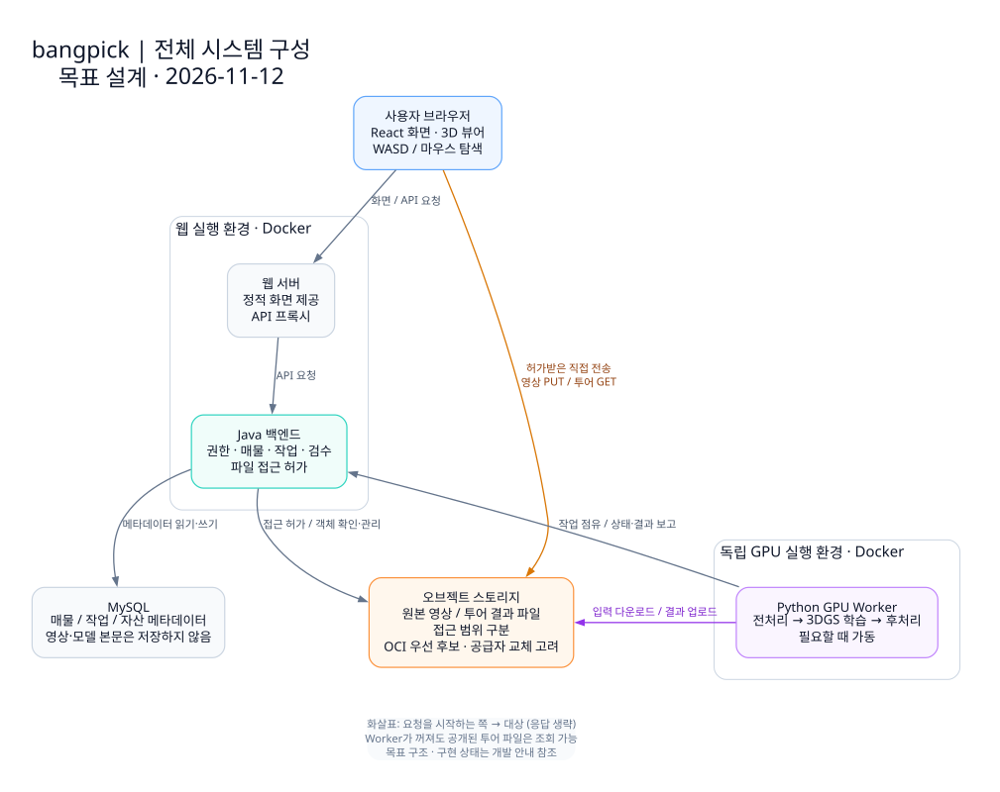

<h1 align="center">bangpick</h1>

<p align="center">
  <strong>사진과 영상으로 담은 공간을 웹에서 둘러보는 가상 부동산 투어 플랫폼</strong>
</p>

<p align="center">
  <a href="#프로젝트-소개">소개</a> ·
  <a href="#공간을-둘러보는-경험">서비스 경험</a> ·
  <a href="#기술적-접근">기술적 접근</a> ·
  <a href="#시스템-구성">설계</a> ·
  <a href="docs/README.md">문서</a>
</p>

## 프로젝트 소개

bangpick은 **3D Gaussian Splatting으로 재구성한 실내 공간과 부동산 매물 정보를 연결하는 프로젝트**입니다.

지도 기반 매물 탐색과 공간 안을 이동하는 가상 투어를 결합하여, 사진만으로 파악하기 어려운 방의 배치와 공간 관계를 살펴보는 경험을 다룹니다. 컴퓨터 비전과 3D 그래픽스, 웹 기술을 통합하는 컴퓨터소프트웨어공학과 학부 캡스톤디자인 프로젝트입니다.

## 공간을 둘러보는 경험

서비스가 다루는 사용자 흐름은 다음과 같습니다.

- **매물 탐색** — 지도와 매물 정보를 통해 관심 있는 공간을 찾습니다.
- **실내 투어** — 매물에 연결된 3D 공간에서 시점을 바꾸고 이동하며 내부를 살펴봅니다.
- **공간 정보 확인** — 재구성된 장면과 별도로 관리하는 실측값·평면도 정보를 구분해 확인합니다.

## 기술적 접근

여러 시점에서 촬영한 실내 사진·영상으로 카메라 위치를 추정하고, 3D Gaussian Splatting으로 장면의 모습을 재현합니다. 생성된 장면은 정리와 웹 제공용 변환을 거쳐 브라우저에서 탐색하는 구조입니다.

```text
다중 시점 사진·영상 → 카메라 위치 추정 → 3DGS 재구성
                                        ↓
                            장면 정리·웹 제공용 변환
                                        ↓
                          매물 정보와 연결된 웹 가상 투어
```

3DGS의 시각적 재현은 실제 공간의 치수·구조 정확성을 보증하지 않습니다. 시각적 장면, 이동 가능 영역, 실측 정보를 구분하는 것을 원칙으로 합니다.

## 시스템 구성



백엔드는 매물·권한·작업 상태를 관리하고, 원본 영상과 투어 파일은 오브젝트 스토리지에 보관합니다. 독립된 GPU Worker가 재구성을 수행하며 브라우저는 공개된 결과를 불러와 렌더링합니다. 파일 전송은 백엔드의 허가를 거칩니다.

스토리지 공급자 연동은 별도 어댑터로 분리하고, 업무 로직과 자산 식별자가 특정 공급자의 SDK·임시 URL에 종속되지 않도록 설계합니다. 그림은 목표 구조이며 초기 프로젝트 구성 이후의 기능은 아직 구현 전입니다.

자세한 흐름과 설계 원칙은 [시스템 설계](docs/architecture.md), 보고서에 재사용할 SVG·PNG와 편집 원본은 [시각 자료 모음](docs/diagrams/README.md)에서 확인할 수 있습니다.

## 문서

- [프로젝트 정의](docs/project.md)
- [시스템 설계와 처리 흐름](docs/architecture.md)
- [설계 시각 자료](docs/diagrams/README.md)
- [개발 환경과 실행 안내](docs/development.md)
- [Docker 실행 안내](infra/README.md)
- [기술 결정 기록](docs/decisions/README.md)
- [실험 기록](docs/experiments/README.md)
- [기여 및 협업 안내](CONTRIBUTING.md)

## 팀

| 구성원 | 주 담당 영역 |
| --- | --- |
| [@Bang9634](https://github.com/Bang9634) | 웹, 기초 백엔드, 서비스 흐름 및 DB 설계 |
| [@skdks2525](https://github.com/skdks2525) | 3DGS 입력 전처리·재구성 및 결과물 정리 |
| [SeongJunKim (@snw-stack)](https://github.com/snw-stack) | GPU 인프라 구성 및 최적화 |

담당 영역은 고정된 작업 경계가 아니며 서로 개발과 검증을 지원합니다.
