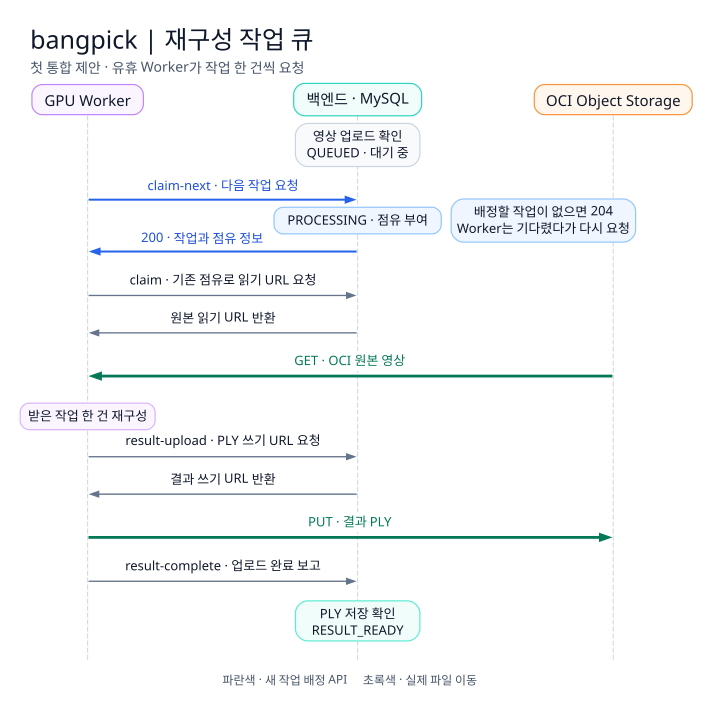

# 재구성 작업 큐 계약 초안

이 문서는 백엔드와 GPU Worker가 병렬로 구현하기 위한 제안입니다. 현재 `media_jobs`에는 업로드가 확인된 작업이 `QUEUED`로 들어갑니다. Worker는 작업 ID를 지정해 점유하고 결과를 등록할 수 있습니다. 자동 배정 API, 점유 갱신과 실패 보고는 아래 제안에 포함됩니다. [현재 영상·PLY 전송 계약](README.md#영상ply-전송)

## 첫 통합 범위



`jobId`는 작업의 ID이고, `leaseId`는 **이번 배정에서 그 작업을 처리할 권한**을 나타내는 ID입니다. 같은 작업을 다른 Worker가 다시 받으면 `jobId`는 같고 `leaseId`는 바뀝니다.

| 담당 | 구현 범위 |
| --- | --- |
| 백엔드 | 기존 `media_jobs`를 큐로 사용합니다. 업로드 확인 시 대기열에 들어간 시각을 기록하고, 다음 작업 선택과 점유 부여를 한 트랜잭션에서 처리합니다. |
| Worker | 유휴 상태에서 백엔드에 다음 작업을 요청합니다. 받은 작업을 로컬에서 한 건씩 처리하고, 기존 OCI 전송과 완료 API를 사용합니다. |

서로의 구현을 기다리는 동안 백엔드는 모의 Worker 요청과 테스트 스토리지로 검증할 수 있습니다. Worker는 아래 `200`·`204` 응답을 재현하는 테스트 서버나 HTTP 모의 테스트를 사용합니다. 실제 GPU 학습을 연결하기 전에는 준비된 테스트 PLY로 배정부터 결과 등록까지 확인할 수 있습니다.

## 대기 작업 배정 API

**제안 경로** `POST /api/internal/media/jobs/claim-next`

요청 본문은 비워 둡니다. 기존 Worker용 `Authorization: Bearer <token>`으로 인증하며, 응답에 `Cache-Control: no-store`를 사용합니다.

작업이 있으면 `200 OK`와 아래 JSON을 반환합니다. 두 ID는 UUID 문자열이고 `leaseExpiresAt`은 UTC ISO 8601 시각입니다.

```json
{
  "jobId": "11111111-1111-4111-8111-111111111111",
  "leaseId": "22222222-2222-4222-8222-222222222222",
  "leaseExpiresAt": "2026-01-01T15:00:00Z"
}
```

| 응답 | Worker 동작 |
| --- | --- |
| `200` | 파일을 내려받기 전에 `<work-dir>/<jobId>/lease`에 점유 ID를 저장합니다. 이 작업의 처리가 끝날 때까지 다음 작업을 요청하지 않습니다. |
| `204` | 지금 배정할 작업이 없거나 다른 요청이 해당 작업을 잠근 상태입니다. 응답 본문 없이 반환하며, Worker는 JSON을 읽지 않고 잠시 기다렸다가 다시 요청합니다. 유휴 요청 간격은 우선 5초를 제안합니다. |
| `401` | 자동 요청을 멈추고 Worker 토큰 설정 오류를 표시합니다. |
| `5xx` 또는 요청 시간 초과 | 배정이 DB에 저장된 뒤 응답이 유실됐을 수도 있습니다. 요청 간격을 늘려 다시 시도합니다. 재요청은 별도 배정 요청이며, 응답이 유실된 작업은 점유 만료 정책을 따릅니다. |

현재 Worker의 `Transfers.command()`는 모든 성공 응답을 JSON으로 읽고 HTTP 오류를 문자열 메시지로 바꿉니다. `claim-next`를 연결할 때는 응답 상태를 먼저 확인해 `204`의 빈 본문을 정상 처리하고, 오류 메시지를 파싱하지 않고도 `401`과 통신 장애를 구분할 수 있게 합니다.

### 백엔드 배정 규칙

1. 원본 업로드 확인이 성공해 `UPLOADING`에서 `QUEUED`로 바뀔 때 `queued_at`을 기록합니다. 중복 완료 요청은 같은 작업을 다시 넣거나 대기 순서를 바꾸지 않습니다. 기존 `QUEUED` 행에 대기 시각을 채우는 방법은 마이그레이션에서 정하며, 과거 시각을 알 수 없는 행은 동일한 기준 시각과 ID로 순서를 정할 수 있습니다.
2. `QUEUED` 작업을 `queued_at`, `id` 순으로 선택합니다. MySQL에서 `FOR UPDATE SKIP LOCKED`로 행을 잠그고, 같은 트랜잭션에서 `PROCESSING`과 새 `leaseId`, 만료 시각을 저장합니다. 이 정렬에는 `(status, queued_at, id)` 인덱스를 검토합니다. 이미 다른 요청이 잠근 작업은 건너뜁니다. [MySQL 잠금 읽기](https://dev.mysql.com/doc/refman/8.4/en/innodb-locking-reads.html)
3. `claim-next`는 DB 배정만 처리합니다. 원본 읽기 URL은 배정 응답을 받은 Worker가 별도로 요청합니다. 기존 수동 `claim`도 같은 행의 상태와 점유를 확인해야 하므로, 자동 배정과 동시에 호출돼도 현재 점유가 유지돼야 합니다.
4. 기본 브랜치에 먼저 병합된 Flyway 마이그레이션 번호를 확인해 새 번호를 정합니다. Google 로그인과 통합할 때는 새 경로도 기존 Worker 토큰으로 인증하며, 브라우저 세션과 CSRF 토큰을 요구하지 않도록 확인합니다.

### 기존 원본·결과 전송과 연결

| 순서 | 호출 |
| --- | --- |
| 원본 읽기 URL | 기존 `POST /api/internal/media/jobs/{jobId}/claim`에 `{"leaseId":"<받은 UUID>","refreshOnly":true}`를 보냅니다. 기존 형식인 `{leaseId, leaseExpiresAt, extension, transfer}`을 받습니다. |
| 원본 다운로드 | 받은 `transfer.url`에서 OCI로 직접 `GET`합니다. URL이 만료되면 같은 점유로 위 호출만 다시 합니다. |
| 결과 업로드 | 기존 `result-upload`에 `{leaseId, sizeBytes}`를 보내고, 받은 OCI URL에 PLY를 `PUT`합니다. |
| 완료 등록 | 기존 `result-complete`에 `{leaseId}`를 보냅니다. 완료가 이미 저장됐지만 응답만 유실됐다면, 같은 점유로 다시 요청해 `RESULT_READY`를 확인합니다. |

`refreshOnly`는 기존 `claim` 요청에 추가할 선택 필드입니다. `true`이면 유효한 UUID 형식의 `leaseId`가 필요하며, 빠졌거나 형식이 잘못되면 `400`을 반환합니다. 해당 작업이 없으면 `404`, 점유가 만료됐거나 바뀌었으면 `409`를 반환합니다. 읽기 URL을 발급해도 점유 ID와 만료 시각은 유지합니다. 필드를 생략하는 수동 CLI는 기존 방식대로 작업 ID를 지정해 점유할 수 있습니다.

Worker는 자동 배정에서 받은 `jobId`와 `leaseId`를 실행이 끝날 때까지 보관하고, 모든 호출에 이 값을 사용합니다. 자동 실행과 수동 실행은 다운로드 이후의 처리 단계를 공유합니다. 여러 Worker를 실행할 때는 각각 별도의 작업 폴더를 사용합니다. 실행 중 `lease` 파일을 다시 읽어서 다른 배정의 ID로 바꾸면 안 됩니다. 읽기 URL 요청이나 결과 등록이 `409`로 거절되면 이 실행을 종료하고 다음 작업을 요청합니다.

## 자동 운영 전 보완 범위

첫 통합에서는 기존 6시간 점유를 유지하고 `QUEUED`만 자동 배정합니다. 배정 응답이 유실되거나 Worker가 중단되면, 작업은 점유가 만료된 뒤에도 `PROCESSING`에 남습니다. 자동 Worker를 다시 켜도 이 작업이 이어서 실행되지는 않습니다. 이 단계에서는 운영자가 작업 ID를 찾아 기존 수동 `claim`으로 다시 받아야 합니다. 아래 만료 처리와 실패 보고를 검증한 뒤 무인 실행에 사용합니다.

| 제안 API | 요청과 처리 |
| --- | --- |
| `POST /api/internal/media/jobs/{jobId}/renew-lease` | `{leaseId}`를 받습니다. 현재 점유가 유효하면 만료를 연장하고 `200 {leaseExpiresAt}`을 반환합니다. 만료되거나 다른 점유로 바뀌었으면 `409`를 반환합니다. |
| `POST /api/internal/media/jobs/{jobId}/fail` | `{leaseId, stage, code}`를 받습니다. 현재 점유가 유효하면 백엔드가 재배정 여부를 결정하고 `200 {jobId, status}`를 반환합니다. 지난 점유의 실패 보고에는 `409`를 반환합니다. |

- **점유 갱신**은 학습 명령이 실행 중일 때도 동작해야 합니다. 예를 들어 점유를 10분으로 두고 Worker가 1분마다 갱신할 수 있습니다. 마지막으로 확인한 만료 시각까지 갱신하지 못하거나 `409`를 받으면 해당 실행에서 새 업로드 URL 발급과 결과 완료 보고를 중단합니다. 이미 완료 요청을 보냈다면 같은 점유의 완료 응답을 확인하는 재요청은 기존 계약을 따릅니다. GPU 작업이 멈춘 채 점유만 갱신되지 않도록 실제 학습 시간을 측정해 작업 실행 한도도 정합니다.
- **점유 만료**는 백엔드가 처리합니다. 만료된 `PROCESSING`을 다시 `QUEUED`로 넣을 때 대기 시각을 갱신해 기존 대기 작업 뒤에 두고, 시도 한도를 넘긴 작업은 `FAILED`로 종료합니다. 새 배정에는 새 `leaseId`를 사용하고, 이전 `leaseId`의 결과 등록 요청은 거부합니다.
- **실패 분류**는 Worker가 처리 단계와 코드를 보내고 백엔드가 결정합니다. 예시는 `DOWNLOAD / STORAGE_TEMPORARY`와 `COLMAP / LOW_REGISTRATION`입니다. 앞의 경우는 한도 내에서 재배정하고, 뒤의 경우는 같은 입력과 설정으로 반복하기 어려우므로 `FAILED`로 종료합니다. 시도는 새 점유를 부여할 때만 집계하고, 첫 시도를 포함해 최대 3회를 초기안으로 둡니다. 수동 배정도 같은 시도 한도와 상태 전환 규칙을 적용합니다.
- **상태 조회**에 `FAILED`를 노출할 때는 실패 코드와 사용자에게 보여줄 설명을 정하고, 프론트의 작업 상태 타입도 함께 갱신합니다. 전송 URL, 토큰, 외부 도구의 원문 로그는 실패 응답에 포함하지 않습니다.

## 구현 전에 합의할 것

| 상황 | 두 담당자가 먼저 맞출 내용 |
| --- | --- |
| Worker가 일을 요청함 | 백엔드는 `claim-next`를 만듭니다. Worker는 `200`에서 받은 작업·점유 ID를 기억하고, `204`면 잠시 기다립니다. 응답 예시를 그대로 공유해 각자 모의 테스트를 만듭니다. |
| 다운로드 링크가 만료됨 | Worker는 같은 작업 ID와 점유 ID로 `refreshOnly: true`를 보내 링크만 다시 받습니다. 기존 수동 실행은 작업 ID를 지정하는 지금 방식을 사용합니다. |
| Worker가 꺼짐 | 첫 통합에서는 점유 만료 후 사람이 작업을 다시 실행합니다. 자동 운영에서는 백엔드가 만료된 작업을 다시 넣습니다. 점유 갱신 주기와 최대 실행·재시도 한도는 팀 GPU에서 실제 소요 시간을 측정한 뒤 확정합니다. |
| 작업을 다시 시도해도 해결되지 않음 | 예를 들어 COLMAP에 사진이 너무 적게 등록된 경우 Worker가 어떤 `stage`와 `code`를 보낼지 정합니다. 백엔드는 그 조합을 받아 다시 대기시킬지 실패로 끝낼지 결정합니다. |

## 첫 통합에서 확인할 것

| 테스트 방법 | 통과 기준 |
| --- | --- |
| 큐를 비우거나, 업로드 완료 API가 호출되기 전 작업만 둡니다. | Worker가 `204`를 받고 다음 요청까지 기다립니다. |
| 작업 A가 먼저 등록되도록 두고, 그 뒤 작업 B를 등록합니다. Worker 하나로 순서대로 요청합니다. | A가 먼저 배정됩니다. Worker는 A의 처리를 마친 다음 B를 요청합니다. |
| MySQL에 작업을 하나만 넣고 두 Worker가 동시에 요청합니다. 수동 CLI와 자동 요청을 동시에 보내는 경우도 확인합니다. | 해당 작업에 대한 활성 점유는 하나뿐입니다. 자동 요청 두 건 중 한 건만 작업을 받고, 같은 작업을 향한 수동 요청은 이미 유효한 점유가 있으면 충돌로 처리됩니다. |
| 결과 등록 전 유효한 점유로 다운로드 URL을 다시 받습니다. 이어 점유를 만료시키거나 재배정한 뒤, 이전 점유로 읽기 URL과 결과 등록을 요청합니다. | 유효한 요청은 URL만 새로 받습니다. 만료되거나 바뀐 점유는 `409`를 받고 현재 점유와 결과가 유지됩니다. |
| 작업을 받은 Worker를 중단하고 다시 켭니다. 점유를 만료시킨 후 수동으로 작업을 다시 받습니다. | 자동 요청은 기존 작업을 건너뜁니다. 수동 요청은 같은 작업 ID에 새 점유 ID를 받습니다. 테스트에서는 시각을 제어하거나 만료된 작업을 준비해 6시간을 기다리지 않습니다. |
| Worker에 브라우저 자격 증명 또는 틀린 토큰을 넣습니다. | `401`이 반환되고 Worker는 계속 요청하지 않습니다. |
| 배정된 작업의 원본을 받고 테스트 PLY를 올립니다. 완료 요청을 두 번 보내고 소유자 인증으로 미리보기를 열어 봅니다. | 작업이 `RESULT_READY`로 바뀌고, 두 번째 완료 요청은 같은 성공 상태를 돌려줍니다. 소유자는 기존 경로로 PLY를 읽을 수 있습니다. |

## 자동 운영 전에 추가로 확인할 것

Worker를 학습 중에 종료하거나 배정 응답을 일부러 끊어, 점유 만료 후 같은 작업을 다시 받을 수 있는지 확인합니다. 재배정 뒤 이전 점유의 결과 등록은 거부되어야 합니다. 일시 장애는 설정한 시도 한도 안에서 재시도되고, 입력 문제나 한도 초과는 `FAILED`로 종료되어야 합니다. 마지막으로 팀 GPU에서 대표 원룸 영상 하나를 자동 배정부터 실제 재구성, OCI 저장, 웹 미리보기까지 실행합니다.
