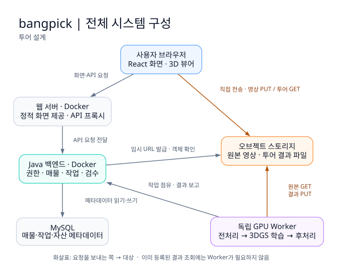
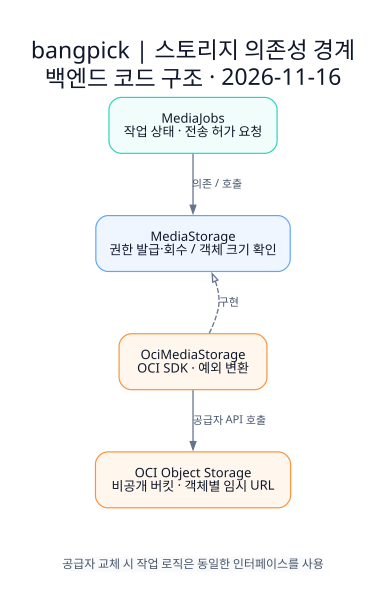

# 시스템 설계

서비스 수준의 그림은 **투어 설계**, OCI 전송 그림은 **현재 개발 환경에서 동작하는 흐름**을 나타냅니다. 현재 코드와 검증 결과는 [개발 안내](development.md)에 있습니다.

## 전체 구성

브라우저는 매물 정보와 작업 상태를 백엔드 API에서 읽고, 허가받은 파일은 오브젝트 스토리지와 직접 주고받습니다. MySQL은 매물·작업·자산 메타데이터를, 스토리지는 원본 영상과 투어 결과를 보관합니다. 백엔드는 파일 본문을 중계하지 않습니다.

GPU Worker는 웹·백엔드와 다른 장비에서 독립 실행할 수 있습니다. Worker가 내부 API에서 작업을 가져오므로 수신 서버를 열 필요가 없습니다. 전처리·학습·후처리는 Worker의 책임이고, 브라우저는 결과를 렌더링하고 이동 제한을 적용합니다. 이미 등록된 PLY의 조회와 렌더링은 Worker 실행 여부에 의존하지 않습니다.

백엔드는 `claim-next`에서 실행 가능한 가장 오래된 `QUEUED` 행을 잠그고 `PROCESSING`으로 바꾼 뒤 작업 ID와 점유 ID를 반환합니다. 잠금과 상태 변경은 짧은 DB 트랜잭션으로 끝납니다. Worker는 점유 ID로 기존 지정 작업 API를 호출해 원본 읽기 URL을 받습니다. Worker의 로컬 처리 명령은 같은 호스트·작업 디렉터리에서 한 번에 하나만 실행하도록 잠급니다. 백엔드 전체의 단일 GPU 실행 수 제한과 만료 점유 복구는 아직 별도 구현이 필요합니다.

Worker가 원본 다운로드 또는 로컬 처리 명령의 실패를 명시적으로 보고하면 백엔드는 현재 점유 ID를 확인하고 재시도 시각을 잡거나 작업을 `FAILED`로 마칩니다. `run-process`가 처리 명령의 시작 실패·0이 아닌 종료 코드를 확인하면 이 경로로 보고합니다. heartbeat 실패처럼 실행 소유권이나 하위 프로세스의 종료가 불확실한 경우에는 자동으로 재대기시키지 않습니다. 기존 점유가 만료됐다는 사실만으로 GPU 계산이 중단됐다고 판단하지 않으므로 만료 작업의 복구는 별도로 설계합니다.

활성 점유자는 `heartbeat`로 만료 시각을 갱신할 수 있습니다. 백엔드는 점유 ID·상태·만료 시각을 확인한 뒤 DB 행만 변경합니다. Worker의 단발 `heartbeat` 명령 외에 `run-process`는 로컬 처리 명령 실행 중 60초마다 갱신합니다. 처리 명령은 아직 전처리·학습 파이프라인에 연결되지 않았습니다.

## 업로드부터 투어 공개까지

서비스 설계에서는 재구성 결과를 한 버전으로 묶어 매물에 연결합니다. 시각 모델, 시작 카메라, 이동 가능 영역은 같은 좌표계를 사용하되 별도 데이터로 관리합니다. 재구성 완료와 검수 승인을 나누고, 공개 투어는 승인된 결과 버전만 가리킵니다. 영상 보관과 재처리 예외는 [원본 보관 정책](decisions/0004-source-video-retention.md)에 있습니다.

## OCI 영상·PLY 전송

1. **영상 등록:** 브라우저가 백엔드에 작업 생성과 쓰기 권한을 요청합니다. 받은 URL로 OCI에 영상을 `PUT`하고, 완료를 알립니다. 백엔드는 쓰기 링크를 회수하고 저장된 객체 크기를 확인한 뒤 작업을 `QUEUED`로 바꿉니다.
2. **Worker 전송:** Worker가 작업을 점유해 읽기 URL로 원본 영상을 `GET`합니다. 준비된 로컬 PLY는 별도의 쓰기 URL로 OCI에 `PUT`합니다. 완료 보고가 오면 백엔드는 쓰기 링크를 회수하고 파일 크기를 확인한 뒤 `RESULT_READY`로 바꿉니다.
3. **미리보기:** 브라우저가 작업 ID로 결과를 요청합니다. 백엔드는 소유자와 상태를 확인하고 MySQL의 결과 키로 읽기 URL을 발급합니다. 뷰어는 OCI에서 PLY를 `GET`해 브라우저에서 렌더링합니다.

이 그림은 작업 ID를 지정한 뒤의 성공한 파일 전송 흐름입니다. 자동 대기열 선택에는 앞서 설명한 `claim-next`를 먼저 호출하며 실패 보고와 재시도는 그림에서 생략했습니다.

개발 버킷은 비공개입니다. 백엔드가 발급한 임시 URL(PAR)은 특정 객체를 읽거나 쓰는 데만 사용합니다. 브라우저·Worker용 토큰은 각각 백엔드 API에만 보냅니다. 원본 키는 `inputs/<작업 ID>/source.<확장자>`, 결과 키는 `outputs/<작업 ID>/<결과 ID>/room.ply`입니다. PLY 쓰기 링크를 다시 발급하면 새 결과 키를 사용합니다. API 경로와 요청 형식, 상태 전환, 만료 규칙은 [서비스 간 계약](../contracts/README.md#영상ply-전송)에 있습니다.

## 스토리지 의존성 경계

`MediaJobs`는 작업 소유자와 점유를 확인하고 상태 전환과 트랜잭션을 관리합니다. `MediaJobRepository`는 SQL·행 잠금·DB 행 변환을 맡습니다. 파일 접근은 `MediaStorage`를 통하며, OCI SDK 호출과 예외 변환은 `OciMediaStorage`에 둡니다. DB에는 결과를 찾는 데 필요한 객체 키를 저장합니다. 만료되는 URL은 요청할 때 발급합니다.

이 경계는 공급자 교체 시 업무 로직과 API의 변경 범위를 줄입니다. 저장된 객체의 이전, 권한·브라우저 전송·비용 검증은 코드의 어댑터 교체와 별개입니다. 이 설계의 배경은 [스토리지와 Worker 분리 결정](decisions/0003-storage-and-worker-flow.md)에 있습니다.
