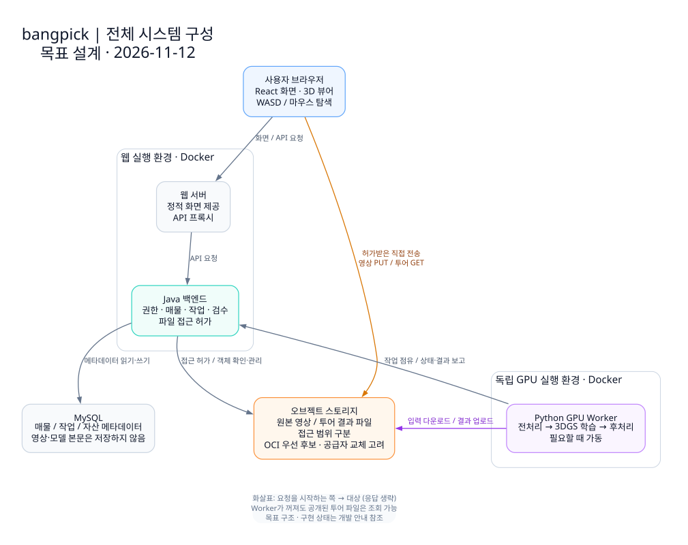
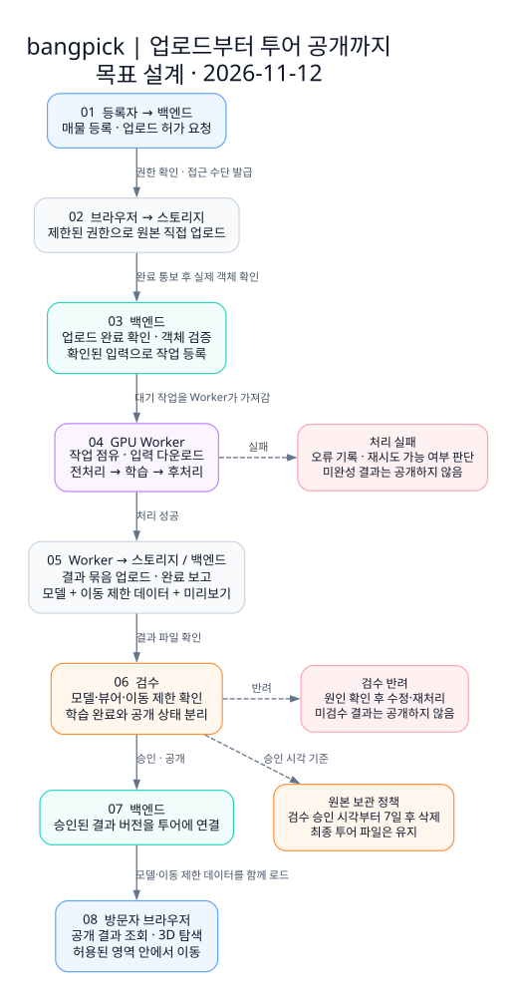
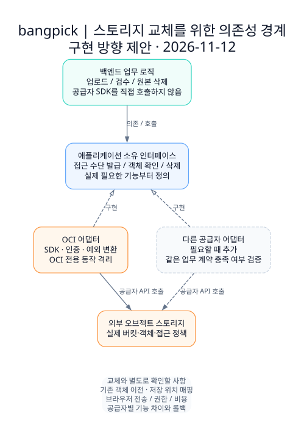

# 시스템 설계

기준일: 2026-11-12. 등록·저장·비동기 처리 구조는 [결정 0003](decisions/0003-storage-and-worker-flow.md), 원본 보관은 [결정 0004](decisions/0004-source-video-retention.md)에 근거합니다. 공급자에 대한 의존성을 격리하고 변경에 대비하라는 사용자 지시를 설계 원칙에 반영했습니다.

아래 그림은 목표 구조이며 현재 구현 상태는 [개발 안내](development.md#현재-구현-상태)에서 관리합니다. 인터페이스 이름과 세부 처리 방식은 구현을 위한 제안입니다. 이 문서는 구조와 처리 책임을 설명하고, 실행 명령은 각 서비스·인프라 안내를 연결합니다.

## 전체 구성

브라우저는 매물 정보와 권한을 백엔드에서 확인하고, 허가받은 파일을 오브젝트 스토리지에서 직접 전송받습니다. 3D 뷰어는 React 화면 안에서 브라우저의 GPU로 장면을 렌더링하는 방향입니다. 학습용 GPU 서버가 사용자 화면을 매번 렌더링해서 전송하는 구조를 전제로 하지 않습니다. 뷰어 라이브러리·내보내기 형식·브라우저 지원 범위는 기존 모델 실험 후 선택합니다.

| 구성 요소 | 책임 |
| --- | --- |
| 프론트엔드 | 지도·매물 화면, 업로드, 작업 상태, 3D 투어 조작 |
| 백엔드 | 사용자·매물 권한, 업로드 확인, 작업·자산·검수 상태, 접근 허가 |
| MySQL | 매물·작업·자산의 메타데이터. 영상·모델 바이너리는 저장하지 않음 |
| 오브젝트 스토리지 | 원본 영상과 투어 결과 파일 보관. 원본과 공개 결과의 접근 범위 분리 |
| GPU Worker | 작업 점유, 입력 다운로드, 전처리·학습·후처리, 결과 업로드·완료 보고 |

웹·백엔드·Worker의 Docker 이미지와 실행 환경은 분리합니다. 여러 컨테이너를 반드시 같은 장비에 배치할 필요는 없습니다. 초기에는 팀 GPU PC를 필요할 때 가동하며, Worker가 꺼져 있어도 이미 공개한 결과를 조회할 수 있어야 합니다. 지도 제공자는 아직 선정 전이므로 그림에서 생략했습니다.

Worker는 인증된 내부 API로 작업을 가져오는 방향이므로 팀 PC에 외부 요청 수신용 서버를 반드시 열 필요는 없습니다. 초기에는 Worker 하나가 한 작업씩 처리하는 방안을 제안합니다. 연결·전원이 끊기면 점유 만료와 복구 정책으로 다루며 자동 재실행과 체크포인트 이어 학습을 구분합니다. FFmpeg·COLMAP·Nerfstudio/gsplat 등 기존 도구는 Python에서 실행을 조정하는 후보이며 별도 재현 실험으로 선정합니다.

## 업로드부터 투어 공개까지

1. 등록자가 매물을 만들고 백엔드에 업로드 허가를 요청합니다. 백엔드는 소유권·허용 형식·크기·저장 위치를 확인하고 제한된 접근 수단을 발급합니다.
2. 브라우저는 원본을 저장소에 직접 업로드한 뒤 완료를 알립니다. 백엔드는 클라이언트의 완료 통보만 믿지 않고 실제 객체의 존재·크기 등 검증 가능한 정보를 확인합니다. 내용 검사는 별도 처리 단계에서 수행할 수 있습니다.
3. 검증된 입력으로 대기 작업을 등록합니다. Worker는 백엔드의 내부 API를 통해 작업을 점유하고, 입력을 내려받아 처리합니다. 초기에는 DB와 내부 API를 이용하며 별도 메시지 브로커를 필수로 도입하지 않습니다.
4. Worker는 모델·이동 제한 데이터·미리보기 등 결과 묶음을 업로드한 뒤 결과 식별자와 버전을 보고합니다. 백엔드는 필요한 파일을 확인하고 검수 가능한 결과로 연결합니다. 큰 파일 전송을 DB 트랜잭션 안에 넣지 않습니다.
5. 모델·뷰어·이동 제한을 검수한 결과만 공개 투어에 연결합니다. 방문자는 조회 권한을 확인한 뒤 결과를 불러와 탐색합니다. 학습 완료, 검수 승인, 공개는 구분합니다.

일반 매물 원본 영상은 검수 승인 후 7일 보관하고 삭제합니다. 최종 투어 파일은 이 삭제 대상이 아닙니다. 검수 반려·재처리·평가용 보관 예외는 [원본 보관 정책](decisions/0004-source-video-retention.md)을 따릅니다. 상세 상태명·API·검수 권한은 구현 전에 계약으로 정의합니다.

## 스토리지 교체를 고려한 경계

업무 로직은 애플리케이션이 소유한 작은 저장소 인터페이스에 의존하고, OCI SDK 호출은 해당 인터페이스를 구현하는 어댑터에 둡니다. 의존성 역전과 Adapter 패턴을 적용할 수 있는 경계입니다. 우선 실제로 필요한 업로드 접근 발급·객체 확인·삭제 기능부터 정의합니다. 이 문서는 해당 클래스가 이미 생성됐다는 뜻이 아닙니다.

- DB에는 자산 ID와 논리적 저장 위치·객체 키·필요한 버전 정보를 보관합니다. 공급자 SDK 객체나 만료되는 URL을 영구 식별자로 저장하지 않습니다. 논리적 저장 위치는 설정에서 실제 공급자·버킷으로 해석합니다.
- 프론트에는 URL·HTTP 메서드·필요 헤더·만료 시각 등 전송에 필요한 계약만 노출합니다. OCI 전용 요청 구조와 인증키를 화면에 전달하지 않습니다. 접근 범위와 만료·회수 방식은 실제 공급자 기능에 맞게 검증합니다.
- Worker는 백엔드가 허가한 전송 수단을 이용하고, Python 작업 파이프라인에 OCI 설정을 흩뿌리지 않습니다. 초기에는 제한된 URL과 HTTP 전송으로 충분한지 확인합니다. SDK 기능이 필요해지면 Python 쪽에도 별도 어댑터를 둡니다. Java 인터페이스 자체를 Python과 공유하지는 않습니다.
- 다른 공급자를 도입할 때 해당 어댑터와 설정을 추가합니다. 모든 공급자가 같은 서명 URL·멀티파트 업로드·CORS·버전 삭제 기능을 제공한다고 가정하지 않습니다. 특수 기능은 필요할 때 별도 기능으로 분리합니다.

인터페이스 분리는 코드 변경 범위를 줄입니다. 이미 저장된 객체의 복사·검증, 기존 자산 참조의 전환, 접근 정책·브라우저 전송·비용 확인까지 자동 해결하지는 않습니다. 실제 이전 시에는 구·신 저장 위치를 함께 해석할 수 있는 기간과 롤백 방식을 계획해야 합니다.

## 스토리지 공급자 검토 — OCI 후보

2026-11-12 공식 자료 검토 기록입니다. 조건은 실제 연동 전에 다시 확인합니다. 사용자 제안에 따라 OCI Object Storage를 우선 후보로 검토합니다. 실제 계정·버킷·브라우저 업로드 검증 전이며 공급자 최종 선정이나 무료 사용 보장 기록이 아닙니다.

OCI Java·Python SDK와 만료·대상·읽기/쓰기 범위를 지정하는 Pre-Authenticated Request(PAR)를 사용할 수 있습니다. 초기 연동은 OCI SDK와 특정 객체에 제한된 단기 업로드 PAR을 사용하는 방안을 제안합니다. PAR URL은 가진 사람이 접근할 수 있으므로 영구 공개 설정이나 브라우저에 계정 인증키를 전달하는 방식과 혼동하지 않습니다. S3 호환 API도 있으나 전체 기능 동등성은 보장되지 않습니다.

공식 Always Free 상세 문서 기준, 체험 종료 후 Always Free 전용 계정은 저장 계층 합산 20GB와 월 50,000회 Object Storage API 요청을 안내합니다. 유료/체험 크레딧 계정에는 Standard·Infrequent Access·Archive 각각 10GB를 안내하며 체험 설명이 별도로 있으므로 실제 계정·리전의 무료 적용 범위를 콘솔에서 확인합니다. 체험 종료 시 무료 용량을 넘긴 경우 객체 삭제 가능성도 공식 문서에서 확인해야 합니다. 무료 용량을 채우려고 실시간 조회용 파일을 Archive에 배치하지 않습니다.

브라우저 접근 시 OCI 공식 FAQ는 CORS 응답 헤더가 고정되어 수정할 수 없다고 안내합니다. AWS의 버킷 CORS 설정을 그대로 전제하지 않고 직접 업로드·뷰어 GET·필요한 요청 헤더·분할 업로드 경로를 실제로 확인합니다. 원본과 공개 결과는 비공개 버킷 및 제한된 접근 권한을 기본으로 검토하고, 공개 투어 제공 방식은 별도로 검증합니다.

일반 매물 원본은 [검수 승인 후 7일 보관·삭제 정책](decisions/0004-source-video-retention.md)을 따릅니다. 삭제 기한은 백엔드의 검수 승인 시각을 기준으로 계산하며 객체 업로드 시각 기준의 수명주기 규칙으로 대체하지 않습니다. 최종 웹 모델은 유지하고 프레임·체크포인트 등 중간 산출물의 보관 범위는 별도로 정합니다. 무료 한도는 버킷마다 독립된 용량으로 계산하지 않습니다.

공식 근거 (2026-11-12 확인): [Always Free 상세 한도](https://docs.oracle.com/en-us/iaas/Content/FreeTier/freetier_topic-Always_Free_Resources.htm), [PAR](https://docs.oracle.com/en-us/iaas/Content/Object/Tasks/usingpreauthenticatedrequests.htm), [OCI SDK](https://docs.oracle.com/en-us/iaas/Content/API/Concepts/sdks.htm), [CORS·S3 호환성 FAQ](https://www.oracle.com/cloud/storage/object-storage/faq/).

## 구현·검토 기준

외부 연동과 업무 규칙을 분리하되, 모든 클래스에 인터페이스를 만들거나 여러 프레임워크를 미리 도입하지 않습니다. 하나의 백엔드 안에서 책임별 모듈을 나누고, 변경 요구와 검증에 도움이 되는 범위에서 추상화합니다.

| 변경 가능성이 큰 부분 | 경계와 검증 기준 |
| --- | --- |
| 스토리지 공급자 | SDK·예외 변환을 어댑터에 격리. 실제 업로드·조회·삭제와 만료·권한 실패를 확인 |
| 학습·후처리 도구 | Worker의 단계별 실행과 입력·결과 계약 분리. 도구 교체 시 웹 API 변경 최소화 |
| 웹 뷰어 | 장면 로딩·좌표·이동 정책을 화면에서 분리. 모델 버전과 이동 제한 데이터의 일치 확인 |
| API·결과 형식 | 프론트·백엔드·Worker가 공유하는 계약과 버전·오류를 `contracts/`에서 관리 |
| 작업 실패·중복 실행 | 점유 만료·동일 작업의 중복 보고·재시도 횟수·취소를 고려. 영구 오류를 무한 재시도하지 않음 |
| 결과 공개 | 업로드 중인 파일 묶음은 공개하지 않음. 완성된 결과 버전을 확인한 뒤 공개 참조를 전환 |

핵심 업무 규칙은 외부 서비스 없이 검증하고, 공급자 기능과 브라우저 동작은 실제 연동으로 별도 확인합니다. 테스트는 구현을 그대로 반복하기보다 권한 위반, 중복 처리, 부분 실패, 이동 경계처럼 문제가 생기기 쉬운 동작에 집중합니다.

## 먼저 확인할 구현

첫 단계는 팀원이 만든 기존 모델 하나를 브라우저에서 로드해 탐색하는 작은 통합 실험입니다. 모델 형식·용량·좌표계를 확인하고, WASD·마우스 조작, 시작점·초기화, 허용 영역 경계, 로딩 시간·메모리·프레임률을 기록합니다. 시각 모델과 별도 이동 제한 데이터를 함께 다룹니다. 전체 업로드 서비스를 만들기 전에 웹 제공이 가능한지 확인하는 목적입니다.

그 다음 실제 저장소에서 모델을 읽는 실험으로 접근 허가·CORS·필요한 전송 기능을 확인하고, 검증한 조건으로 최소 저장소 인터페이스와 업로드 계약을 정의합니다. 이후 영상 하나를 업로드해 Worker가 처리하고 검수 결과를 투어에 연결하는 흐름을 통합합니다. 지도·검색·운영 자동화의 상세화는 이 핵심 경로 검증과 함께 진행합니다.

## 그림 재사용

그림 원본·SVG·PNG와 재생성 방법은 [시각 자료 모음](diagrams/README.md)에 있습니다. 보고서에는 그림 번호·기준일·설계/구현 여부를 함께 적고, 성능 결과는 실험 기록을 별도로 인용합니다.
